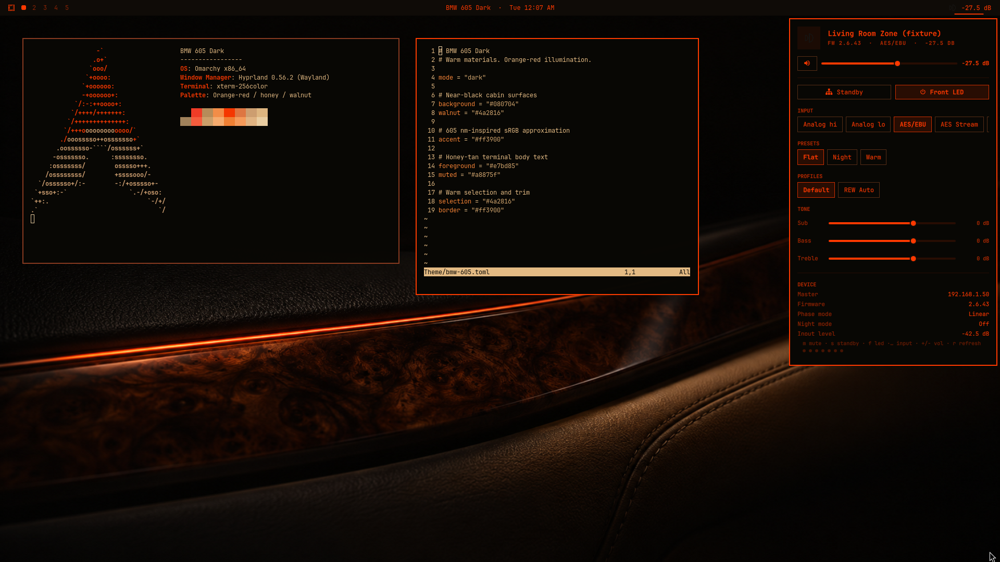

# BMW 605 Dark

[](https://github.com/tcballard/omarchy-badges)
[](artwork/DETAILS.md#compatibility)

**The cabin, after dark.**

Cream leather. Burl walnut. Black trim. Orange-red instruments. A BMW E90 interior distilled into Omarchy.



Honey-tan terminals. Orange-red shell. Four wallpapers.

## 605 nm

BMW’s classic instrument lighting is [605 nm orange-red](https://www.autoblog.com/features/bmw-x4-toyota-tacoma-gauge-illumination). Our `#ff3900` is a CIE-derived sRGB approximation: the hue, adapted for a screen.

## Install

For Omarchy 4. Installs and applies:

```bash
omarchy theme install https://github.com/keylimesoda/omarchy-bmw-605-dark-theme
```

Switch back later:

```bash
omarchy theme set bmw-605-dark
```

Next wallpaper:

```bash
omarchy theme bg next
```

## Details

[Palette, color science, and compatibility](artwork/DETAILS.md) · [Wallpaper credits](artwork/CREDITS.md) · [Theme: MIT](LICENSE)

The speaker widget pictured is optional. Independent theme; no BMW affiliation.
